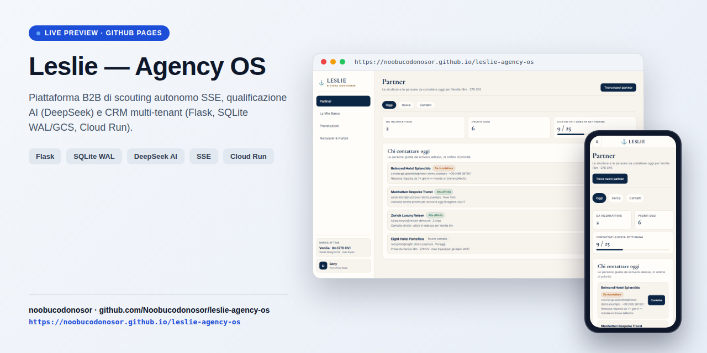

# Leslie — Agency OS (B2B AI Scouting & CRM)

[](https://noobucodonosor.github.io/leslie-agency-os/)

**Anteprima Interattiva Read-Only (GitHub Pages — dati dimostrativi):** [https://noobucodonosor.github.io/leslie-agency-os/](https://noobucodonosor.github.io/leslie-agency-os/)

Piattaforma full-stack di **scouting B2B autonomo, qualificazione lead tramite AI e CRM operativo** progettata per i settori **nautica, ospitalità ed esperienze premium**.

> **Nota sulla privacy:** questo repository pubblico contiene esclusivamente il codice sorgente, i test e la documentazione architetturale (`docs/wiki/`). Nessun database di produzione, nessun lead reale e nessuna chiave API sono presenti nel repository.

## Funzionalità Principali
- **Scouting Autonomo Streaming (SSE):** ricerca multi-nicchia via Google Places API + scraping statico (`BeautifulSoup`) di pagine `/team` e `/about` con estrazione contatti e filtri anti-rumore.
- **Qualificazione AI & Scoring (0–10):** integrazione DeepSeek (`OpenAI-compatible`) con valutazione strutturata JSON, cache e retry automatici.
- **CRM & Commerce Engine Multi-Tenant:** gestione funnel (`saved → contacted → partner`), portale partner dedicato, profili multi-cliente e persistenza SQLite WAL sincronizzata su Google Cloud Storage.
- **Produzione & QA:** containerizzazione Docker + Gunicorn su Google Cloud Run (`europe-west1`), logging strutturato JSON, Wiki tecnica completa ([`docs/LESLIE.md`](./docs/LESLIE.md)) e suite di test end-to-end mockati (`pytest`).

## Stack Tecnologico
- **Backend:** Python 3.11, Flask, Gunicorn, SQLite (WAL) + Google Cloud Storage, SSE
- **AI & Discovery:** DeepSeek API, Google Places API, BeautifulSoup4
- **Frontend:** HTML5, CSS3, Vanilla JS responsive
- **Infra & Test:** Docker, Google Cloud Run, `pytest`

## Avvio Locale
```bash
python3 -m venv .venv && source .venv/bin/activate
pip install -r requirements.txt
cp .env.example .env
pytest
```
