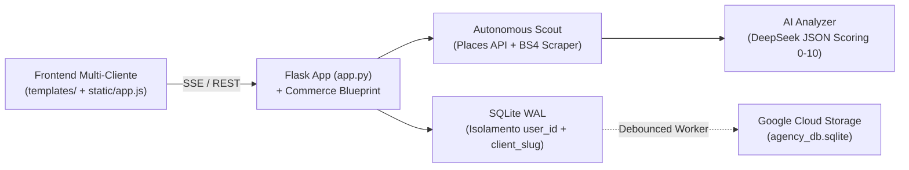

# Architecture Decision Records (ADR) & Master Task Backlog — Leslie Agency OS

Questa cartella raccoglie gli **Architecture Decision Records (ADR)** e il **Master Task Backlog** di **Leslie — Agency OS** (`Noobucodonosor/leslie-agency-os`), integrando la documentazione di dominio in [`Wiki/`](../../Wiki/).

---

## Indice degli ADR

| ID | Titolo | Stato | Priorità | Autori |
| :--- | :--- | :--- | :--- | :--- |
| **[ADR-0001](./0001-architettura-core-leslie.md)** | Architettura Core — Single-Container Flask, Scouting SSE, SQLite WAL + GCS Sync | Accettato | P1 — Alta | Noobucodonosor |
| **[ADR-0002](./0002-hardening-sicurezza-api-dom.md)** | Hardening Sicurezza Endpoint Flask, Validazione JSON, Security Headers e Sanitizzazione DOM | Accettato | P0 — Critica | Noobucodonosor |

---

## Diagramma Architetturale del Sistema

---

## Master Task Backlog

| Task ID | Issue | ADR | Titolo Task | File Coinvolti | Priorità | Assegnatari |
| :--- | :--- | :--- | :--- | :--- | :--- | :--- |
| **TASK-ADR-01** | `#1` | [ADR-0001](./0001-architettura-core-leslie.md) | Inizializzare `AGENTS.md`, `docs/adr/` e template Issue/PR | `AGENTS.md`, `docs/adr/`, `.github/` | **P1 — Alta** | Noobucodonosor |
| **TASK-CI-01** | `#2` | [ADR-0001](./0001-architettura-core-leslie.md) | Aggiungere workflow GitHub Actions CI (`pytest` + `adr-pre-release`) | `.github/workflows/ci.yml`, `.github/workflows/adr-pre-release.yml` | **P1 — Alta** | Noobucodonosor |
| **TASK-SEC-01** | `#3` | [ADR-0002](./0002-hardening-sicurezza-api-dom.md) | Audit sicurezza endpoint Flask, SSE e sanitizzazione input | `app.py`, `static/app.js`, `tests/test_funnel_endpoints.py` | **P0 — Critica** | Noobucodonosor |
